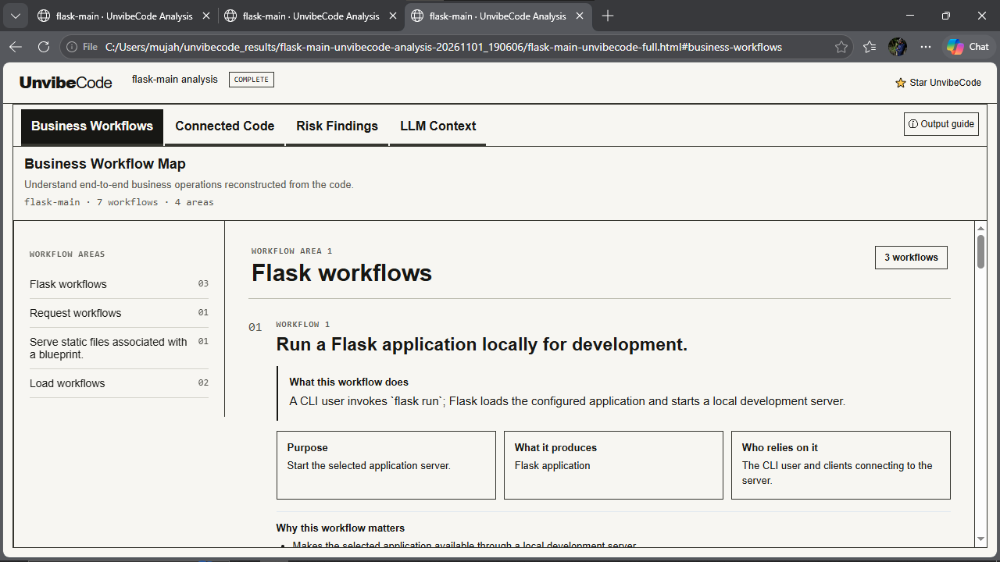
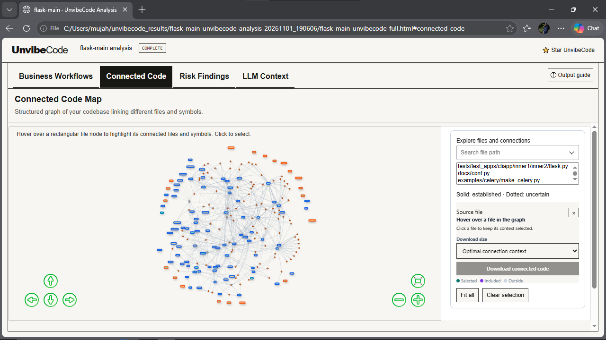
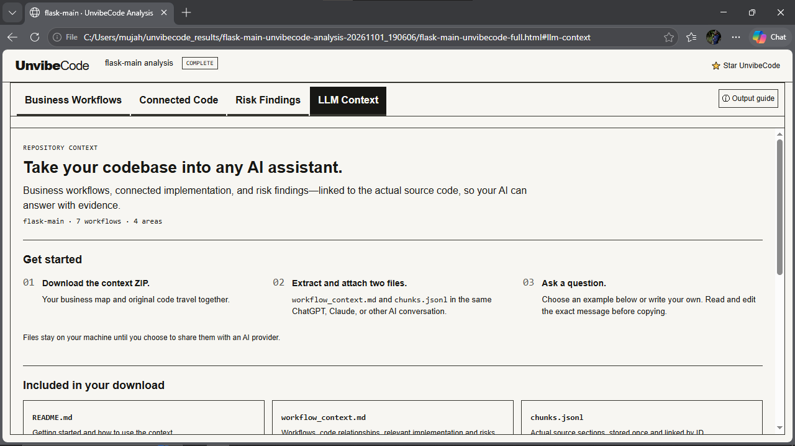

# UnvibeCode Flask Analysis

Exploring AI-assisted codebase understanding with UnvibeCode and Claude.

## Overview

This project documents my hands-on exploration of [UnvibeCode](https://github.com/FinanceFlash/unvibecode) using the open-source Flask repository.

## What I explored

- **Business Workflow Map:** Examined reconstructed application workflows.
- **Connected Code Map:** Explored relationships between code files and symbols.
- **Business Risk Findings:** Reviewed the reported risk-analysis results.
- **Repository Context:** Generated structured code context and tested it with Claude.

## Key observations

- The HTML analysis report was easy to navigate.
- The generated repository context worked successfully with Claude.
- The analysis reported no reportable risks for this run; this does not establish that the repository is entirely risk-free.

## Future improvement idea

Explore a workflow-diff feature that compares successive analyses and highlights changes to workflows, connected code, and evidence-supported findings.

## Technologies and tools

Python · UnvibeCode · Flask · Claude · GitHub

## Screenshots

### 1. UnvibeCode Analysis Overview

### 2. Connected Code Map

### 3. LLM Context

## References

- [UnvibeCode repository](https://github.com/FinanceFlash/unvibecode)
- [Flask repository](https://github.com/pallets/flask)

*This repository documents my analysis and learning experience. It is not the official UnvibeCode project.*
